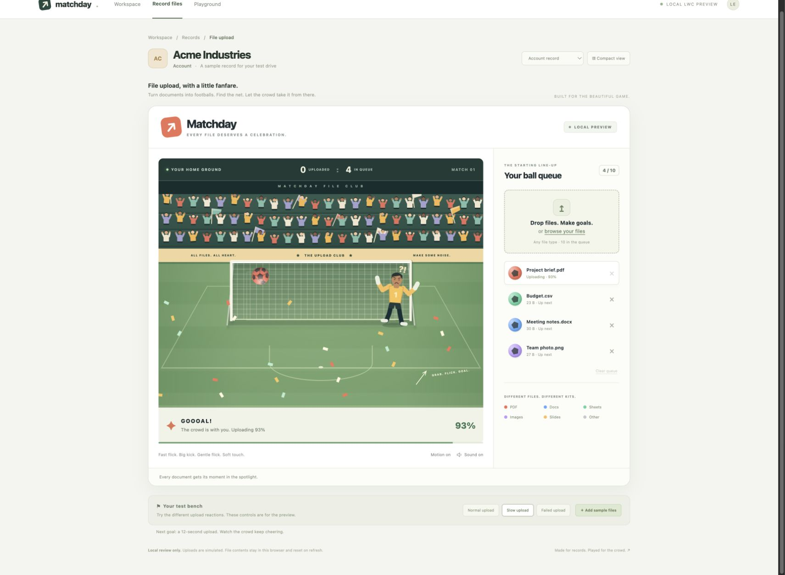

# Matchday File Upload

A football-themed file uploader for Salesforce Lightning record pages. Drop documents into a queue, flick a file-ball toward the goal, and celebrate when Salesforce confirms the attachment.



_Local preview with simulated uploads and sample data._

## What it does

- Queues up to 10 files; ball colors distinguish PDFs, documents, spreadsheets, images, presentations, and other files.
- Uses mouse or pointer movement for direction and power. There is no aim bar or shoot button.
- Keeps the goalkeeper moving, returns saved shots, and increases his pace after goals.
- Starts the real upload only after a goal. The crowd cheers until Salesforce confirms the saved size and record link.
- Adds synthesized kick, net, save, and crowd sounds with an optional sound toggle and reduced-motion support.
- Retains failed files for retry and uses a unique key to reconcile a committed upload after a lost response.

The Salesforce component enforces **10 MiB per file** (10,485,760 bytes, displayed as 10.0 MB). Salesforce file policies, access rules, and storage limits also apply. This component has no object-name restriction; the saved record must support Salesforce Files.

## Install in Salesforce

Requires Salesforce CLI and an org supporting Metadata API **67.0**. Use a development org or sandbox for initial validation.

```sh
git clone https://github.com/leeseifer/matchday-file-upload.git
cd matchday-file-upload

# Log in to a Developer Edition org; the alias is local to your computer.
sf org login web --alias matchday-dev --instance-url https://login.salesforce.com

# Deploy only the reusable uploader metadata and run its Apex tests.
sf project deploy start --target-org matchday-dev \
  --manifest manifest/package.xml \
  --test-level RunSpecifiedTests \
  --tests MatchdayFileUploadControllerTest --wait 20

# Assign the permission set to the logged-in user.
sf org assign permset --target-org matchday-dev --name Matchday_File_Upload
```

For a sandbox login, replace the instance URL with `https://test.salesforce.com`. For SSO, use your org's login URL. Check the target alias before deploying.

Open a saved record, choose **Setup → Edit Page**, drag **Matchday File Upload** onto the page, then save and activate the page for the intended audience. A wide main region works well. This repository does not replace existing record pages.

Users need the **Matchday File Upload** permission set plus their normal Files and record access. For another user, specify `--on-behalf-of USERNAME` when assigning the permission set. The set grants the confirmation Apex class and retry-key field; it does not grant access to additional records.

See [detailed installation and testing](docs/INSTALLATION.md), [architecture](docs/ARCHITECTURE.md), and [troubleshooting](docs/TROUBLESHOOTING.md).

## Try the local preview

Requires Node.js 22 or newer. Salesforce login is not needed for the preview.

```sh
npm ci
npm test
npm run build:preview
npm run preview
```

Open **http://127.0.0.1:4173**. Add sample files or select your own, then flick the ball. Use the normal, slow, and failed upload controls to review the different reactions. The local preview simulates uploads and does not read or send selected file contents. It also offers compact layout and sample record controls.

After building, `prototypes/penalty-file-upload/dist/Matchday-preview.html` is a self-contained local preview that can be opened directly. Generated bundles and dependencies are excluded from Git.

## Project contents

| Path                                                           | Purpose                                               |
| -------------------------------------------------------------- | ----------------------------------------------------- |
| `force-app/main/default/lwc/matchdayRecordUpload`              | Exposed record-page component and real upload adapter |
| `force-app/main/default/lwc/penaltyFileUpload`                 | Game, pointer controls, queue, animation, and audio   |
| `force-app/main/default/classes/MatchdayFileUploadController*` | Read-only attachment confirmation and Apex tests      |
| `force-app/main/default/objects/ContentVersion/fields`         | Unique retry-key field                                |
| `force-app/main/default/permissionsets`                        | Minimum component-specific permissions                |
| `manifest/package.xml`                                         | Scoped deployment manifest                            |
| `prototypes/penalty-file-upload`                               | Local preview harness                                 |

## Validation status

The source has **44 component tests** and **5 Apex tests**. In the original development org, real uploads succeeded for text, JSON, and HEIC, including a 2,108,524-byte image. A separate 10 MiB UI API upload passed with matching checksums. The complete 10 MiB browser path, non-admin users, other object pages, and Salesforce mobile need acceptance testing in the destination org.

Queue and retry keys live in browser memory. Reloading clears the queue and scoreboard but does not remove uploaded Salesforce Files. Check existing Files before reselecting after an interrupted session. Upload progress is indeterminate until server confirmation.

This is a source project, not a managed package or an AppExchange-reviewed product. [Validation details](docs/VALIDATION.md) distinguish source tests from live-org evidence.
